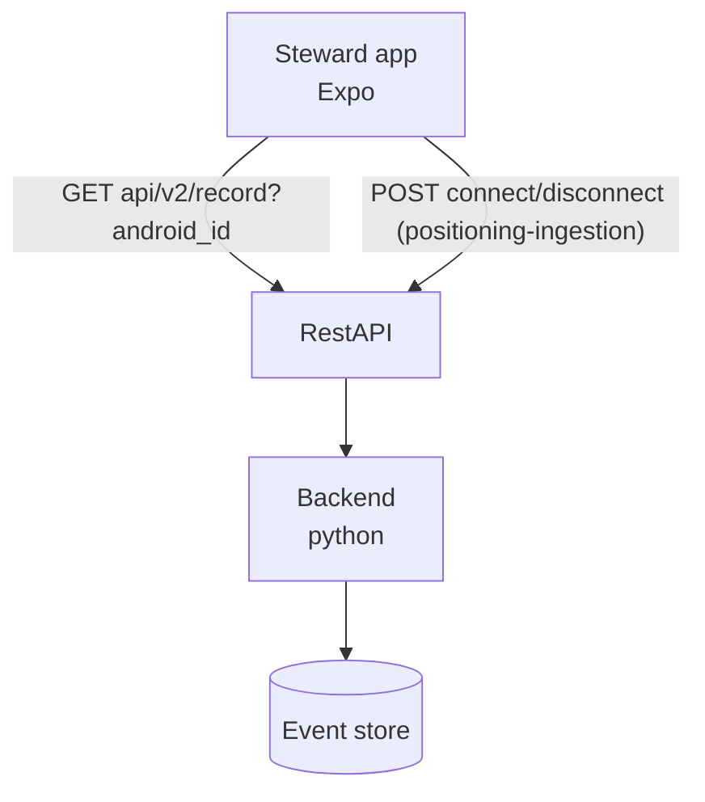

# Patrol Record API

Backend API contract for patrol records. A record bundles one steward's connection to one beacon: the connect event paired with its matching disconnect event, closed at the shift stop event, or left open while the steward is still connected. Records are served for the current shift only, filtered per steward. The steward's Android app uses them for its patrol history view: a section with current connections and a section with closed records.

## Architecture

## Endpoints

- `GET api/v2/record?android_id={id}` - The patrol records ([RecordList]) of one steward for the current shift, both pending (currently open) and registered (closed)

## Implementation Notes

`GET /api/v2/record` returns only records for the steward's current shift; earlier shifts are not included. The backend resolves each record's `beacon_id` to its `RecordArea`, so clients display a place name (e.g. "Frederiksberg platform") instead of a beacon id.

A record's `status` follows the acknowledgement handshake of the ingestion events:

- `pending`: the backend has stored the connect event but no matching disconnect event. The connection is running. Clients show these as current connections and render their own running timer from `started_at` (the connect event's timestamp), measured against `min_patrol_duration_secs` for compliance.
- `registered`: the backend has stored the disconnect event — the same moment the disconnect request is acknowledged (201) — closing the record. Clients show these as previous records.

While a connect or disconnect POST is in flight, the server does not yet know about it: the client's local state is the source of origin (real time), the server's registered state is the source of truth (not always in real time). Two pendings bridge the two truths, both resolved by the ingestion acknowledgements (positioning-ingestion contract):

- Pending for the connect: while `POST /connection/connect` is in flight, the client shows the area name as "Pending" locally. The 201 acknowledgement returns the stored event with the beacon's resolved `RecordArea`, which replaces the placeholder immediately.
- Pending for the disconnect: while `POST /connection/disconnect` is in flight, the client keeps the record pending locally. The 201 acknowledgement registers the record server-side — the same moment the record's status becomes `registered` — so the client can move it to its previous-records section on the acknowledgement.

Clients re-fetch `GET /api/v2/record` to reconcile their local state with what the server has registered, e.g. when the history view opens.

`time` is when the server built the response; clients compute the age of pending records themselves as `now - started_at` and recompute `patrolled` for pending records as `(now - started_at) >= min_patrol_duration_secs`. The server does not push updates; clients re-fetch when their view opens or an ingestion request is acknowledged.

`min_patrol_duration_secs` is set by the backend, derived from the area's type: 10 seconds for platform, 20 seconds for concourse.

## Data Models

### RecordList
- `records`: Record[] — the steward's records for the current shift, most recent first
- `time`: Date — when the server built the response

### Record
- `android_id`: UUID — the steward this record belongs to
- `beacon_id`: UUID — the beacon the steward was connected to
- `started_at`: Date — when the connection started (connect event timestamp)
- `ended_at`: Date | null — when the connection ended; null while pending
- `duration_secs`: integer | null — `ended_at - started_at` in whole seconds; null while pending
- `min_patrol_duration_secs`: integer — how long the visit must last to count as a patrol (10 for platform, 20 for concourse)
- `patrolled`: boolean — whether the visit has lasted at least `min_patrol_duration_secs`
- `status`: enum `"pending"` | `"registered"` — pending while the connection is running; registered once the disconnect event is stored
- `area`: RecordArea — the area of the beacon, resolved by the backend

### RecordArea
- `area_id`: string
- `name`: string — e.g. "Frederiksberg platform"
- `line`: string[] — the metro lines the area serves
- `station_id`: string
- `area_type`: enum `"platform"` | `"concourse"`
