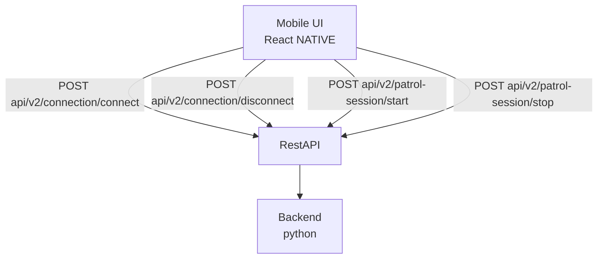

# Positioning Ingestion API

Backend API contract for Android client to ingest connection and patrol session events for positioning data.

## Architecture

## Endpoints

- `POST api/v2/connection/connect` - Report connection established ([connection-event]); the 201 acknowledgement returns the stored event and the beacon's resolved area ([connect-event-stored])
- `POST api/v2/connection/disconnect` - Report connection lost ([connection-event]); the 201 acknowledgement returns the stored event ([stored-event])
- `POST api/v2/patrol-session/start` - Report patrol session started ([patrol-session-event])
- `POST api/v2/patrol-session/stop` - Report patrol session stopped ([patrol-session-event])

## Implementation Notes

All endpoints use POST to maintain an append-only event log. Stewards press "start" and "stop" when taking breaks; during "stop" periods they cannot be tracked by beacons, so explicit logging is required.

Each endpoint corresponds to exactly one action, so event payloads no longer carry a `status` field — the action is implied by which endpoint was called (this replaces v1's combined `/connection-event` and `/patrol-session-event` endpoints).

Posting `patrol-session/stop` also closes any open connections for the device: the server finds every connect event from that `android_id` without a matching disconnect event and appends a disconnect event for each, stamped with the stop `timestamp`. Clients therefore do not need to POST `connection/disconnect` when a session ends; the phone no longer has to keep track of open beacon connections.

Two parallel truths exist around the acknowledgements: the steward working and connecting to beacons in real time (the phone, the source of origin), and what the server has registered (the source of truth, not always in real time). The acknowledgements are where one crosses into the other:

- While a POST is in flight, the server does not know about it; the client shows its own pending state.
- The `POST /connection/connect` 201 acknowledgement returns the stored event plus the beacon's resolved area, so the client can immediately show where it is instead of a pending placeholder. A record of the connection starts server-side at this moment.
- The `POST /connection/disconnect` 201 acknowledgement registers the record: the closed record is now the server's source of truth. The client can move the entry to its history view on the acknowledgement.

The steward's history as registered by the server is served by the patrol-record contract (`../patrol-record/`), `GET api/v2/record?android_id={id}`, which clients re-fetch to reconcile with their local state.

## Data Models

### connection-event
- `android_id`: UUID
- `beacon_id`: UUID
- `timestamp`: Date — when the connection or disconnection occurred on the device

### patrol-session-event
- `android_id`: UUID (android)
- `timestamp`: Date — when the connection or disconnection occurred on the device

### stored-event
- `event_id`: UUID — server-generated identifier of the appended event
- `event_type`: enum `"connect"` | `"disconnect"` | `"shift_start"` | `"shift_stop"`
- `android_id`: UUID
- `beacon_id`: UUID
- `device_timestamp`: Date — when the event occurred on the device, as given in the request
- `server_timestamp`: Date — when the backend recorded the event
- `source`: string — server-assigned origin of the write, e.g. `"API"`

### patrol-area
- `area_id`: string
- `name`: string — e.g. "Frederiksberg platform"
- `line`: string[] — the metro lines the area serves
- `station_id`: string
- `area_type`: enum `"platform"` | `"concourse"`

### connect-event-stored
- [stored-event] plus:
- `area`: patrol-area — the beacon's area, resolved by the backend
