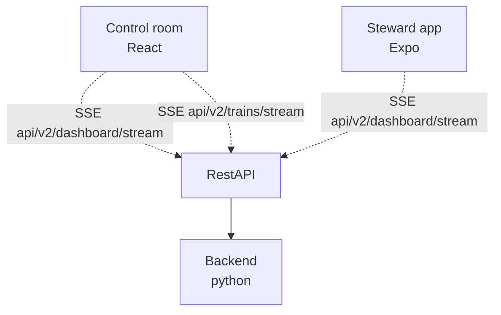

# Positioning Interface API

Backend API contract for station and train presence positioning data. Consumed by the control room dashboard (Web UI) and the steward Android app.

## Architecture



## Endpoints

- `GET api/v2/dashboard/stream` - Server-Sent Events stream of [Dashboard] updates (stations only)
- `GET api/v2/trains/stream` - Server-Sent Events stream of [TrainsUpdate] updates (trains + manning percentages)
- `GET api/v2/config/at-risk-threshold` - At-risk threshold configuration ([AtRiskThreshold])
- `POST api/v2/config/at-risk-threshold` - Update the at-risk threshold; accepts an [AtRiskThreshold] body and returns the updated configuration
- `GET api/v2/coverage/at-risk-count` - Number of at-risk episodes in a shift ([AtRiskCount])

## Implementation Notes

`/api/v2/dashboard/stream` is a Server-Sent Events (SSE) stream (`text/event-stream`), not a WebSocket and not a polled REST resource. Every message is an SSE event named `dashboard` whose `data` is a JSON-encoded [Dashboard] (stations only — trains have their own stream):

```
event: dashboard
data: {"stations": [...], "time": "2026-09-21T10:15:00+00:00"}
```

`/api/v2/trains/stream` is a second SSE stream on the same API. Every message is an SSE event named `trains` whose `data` is a JSON-encoded [TrainsUpdate] — every train plus the manning percentages computed in the backend on every event (never stored; trains are not persisted state, the events are):

```
event: trains
data: {"trains": [...], "manning_percent": 70, "m1m2_manning_percent": 50, "m3m4_manning_percent": 100, "time": "2026-09-21T10:15:00+00:00"}
```

- Every event on either stream contains the full payload for that stream, changed or not, so clients need no separate initial fetch and replace their whole state on each event.
- An event is sent each time the server recomputes coverage (dashboard stream) or train manning from the events (trains stream): when a positioning or patrol session event arrives, and periodically. An event is sent even when nothing changed.
- `time` is when the server sent the event.
- `overdue_at` is a point in time, not a duration. Clients count down to it themselves, so the server does not push an event every second.
- Browsers reconnect an SSE stream automatically. After a reconnect the first event is again the full dashboard.

## Data Models

### Dashboard
- `stations`: Station[]
- `time`: Date — when the server sent this event

### TrainsUpdate
- `trains`: Train[]
- `manning_percent`: number | null — manning percentage (0..100) over all trains; null when no running time
- `m1m2_manning_percent`: number | null — same percentage over trains whose `line` contains M1 or M2
- `m3m4_manning_percent`: number | null — same percentage over trains whose `line` contains M3 or M4
- `time`: Date — when the server sent this event

### Station
- `station_id`: string
- `name`: string
- `areas`: Area[]

### Area
- `area_id`: string
- `name`: string
- `line`: string[] — the metro lines the area serves (e.g. `["M1", "M2"]` for an interchange)
- `area_type`: enum `"platform"` | `"concourse"`
- `covered_now`: boolean
- `overdue_at`: Date | null — when the area becomes (or became) overdue; null while covered now or when never patrolled

### Train
- `train_id`: UUID
- `slug`: string
- `current_steward_ids`: UUID[] — the stewards currently manning the train; empty when unmanned
- `line`: string[] — the metro lines the train serves (e.g. `["M1", "M2"]`)

### AtRiskThreshold
- `at_risk_threshold_minutes`: integer (minimum 1) — minutes before an area becomes overdue when it is considered at-risk

### AtRiskCount
- `shift_start`: Date — the start of the shift the episodes were counted for
- `episodes`: integer (minimum 0) — how many areas have been at-risk in the shift; an area that is patrolled and later becomes at-risk again counts as a new episode

The count is per episode, not per unique area. It is derived from the same
coverage recomputes that feed `/api/v2/dashboard/stream`: each time the server
recomputes coverage, an area whose remaining time until `overdue_at` is within
`at_risk_threshold_minutes` is counted once. Without the `shift_start` query
parameter (ISO 8601 with offset), the latest shift from the server's shift
schedule is used.
