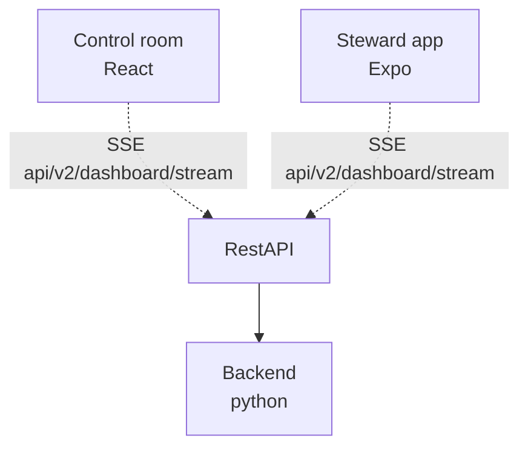

# Positioning Interface API

Backend API contract for station and train presence positioning data. Consumed by the control room dashboard (Web UI) and the steward Android app.

## Architecture



## Endpoints

- `GET api/v2/dashboard/stream` - Server-Sent Events stream of [Dashboard] updates
- `GET api/v2/config/at-risk-threshold` - At-risk threshold configuration ([AtRiskThreshold])

## Implementation Notes

`/api/v2/dashboard/stream` is a Server-Sent Events (SSE) stream (`text/event-stream`), not a WebSocket and not a polled REST resource. Every message is an SSE event named `dashboard` whose `data` is a JSON-encoded `Dashboard`:

```
event: dashboard
data: {"stations": [...], "trains": [...], "time": "2026-09-21T10:15:00+00:00"}
```

- The first event after connecting contains every station and train, so clients need no separate initial fetch.
- Later events contain only the stations and trains whose state changed. Clients replace their copy of each station by `station_id` and each train by `train_id`.
- `time` is when the server sent the event.
- `overdue_at` is a point in time, not a duration. Clients count down to it themselves, so the server does not push an event every second.
- Browsers reconnect an SSE stream automatically. After a reconnect the first event is again the full dashboard.

## Data Models

### Dashboard
- `stations`: Station[]
- `trains`: Train[]
- `time`: Date — when the server sent this event

### Station
- `station_id`: UUID
- `name`: string
- `areas`: Area[]

### Area
- `area_id`: string
- `name`: string
- `line`: string
- `area_type`: enum `"platform"` | `"concourse"`
- `covered_now`: boolean
- `overdue_at`: Date | null — when the area becomes (or became) overdue; null while covered now or when never patrolled

### Train
- `train_id`: UUID
- `slug`: string
- `total_time_secs`: integer
- `manned_time_secs`: integer
- `current_steward_id`: UUID | null

### AtRiskThreshold
- `at_risk_threshold_secs`: integer — seconds before an area becomes overdue when it is considered at-risk
