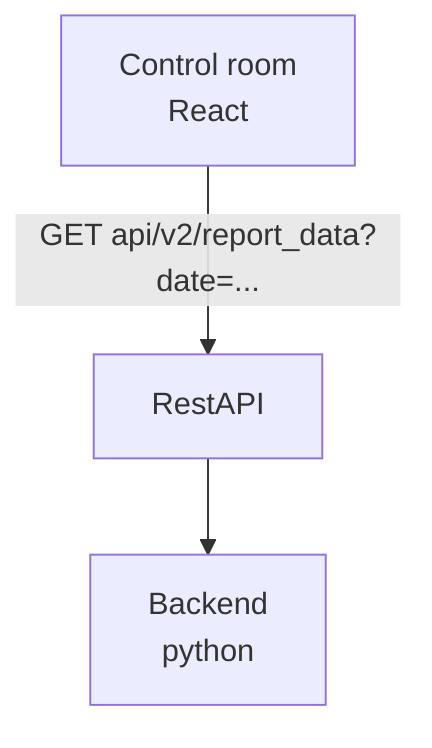

# Report API

Backend API contract for the historical compliance report of one shift. Consumed by the control room dashboard (Web UI) to show, after a shift has ended, how the manning and patrol requirements were held during that shift.

## Architecture

## Endpoints

- `GET api/v2/report_data?date={YYYY-MM-DD}[&known_at={ISO 8601}]` - Historical compliance report of the night shift starting on `date` ([ReportData])

## Implementation Notes

`GET /api/v2/report_data` is a plain one-shot REST GET, not a stream: the report is generated on request and the database is only read, never written.

- `date` is the **local date (Europe/Copenhagen) the shift starts on**. A night shift runs past midnight, so the shift starting on `date` also covers the early hours of the next day.
- The report is rebuilt from the append-only, hash-chained event log using the **same coverage and manning computation as the live dashboard streams** (`/api/v2/dashboard/stream`, `/api/v2/trains/stream`), so a report matches what the dashboard showed. It is evaluated at the **shift end**, so asking for a finished shift the next morning gives the final picture.
- The optional `known_at` query parameter (ISO 8601 **with timezone offset**) restricts the report to events the backend had received by that moment, evaluated no later than that moment — use it to reproduce what was known at a specific time. Without it, every stored event is used, including late arrivals.
- Station names and lines are resolved server-side; `train.slug` is the train's human-readable identifier. Per-train steward ids are deliberately not included: they are pseudonymous and shift-scoped.
- The aggregate `manning_percent` / `m1m2_manning_percent` / `m3m4_manning_percent` use the same 0..100 scale and the same line-group split as the trains stream. Each percentage is calculated by dividing total manned time by total time in service across the trains in scope over the reporting period. The 70% night-shift target applies to the overall fleet percentage.
- Auth: the endpoint requires the `historical_data` permission, granted only to the **operations_administrator** role. Requests without a bearer token get `401`; any other role gets `403`. `400` with an [Error] body when the shift had not started yet, or when `known_at` has no timezone offset.

## Data Models

### ReportData
- `shift`: ShiftBoundary — scheduled start and end of the reported shift (UTC)
- `as_of`: Date — the moment the report is evaluated at (the shift end, or earlier with `known_at`)
- `known_at`: Date | null — the server-time cutoff used; null when all stored events were used
- `stations`: ReportStation[]
- `trains`: ReportTrain[]
- `manning_percent`: number | null — manned-time share (0..100) over all trains; null when no running time
- `m1m2_manning_percent`: number | null — same over trains whose `line` contains M1 or M2
- `m3m4_manning_percent`: number | null — same over trains whose `line` contains M3 or M4

### ShiftBoundary
- `start`: Date
- `end`: Date

### ReportStation
- `station_id`: string (e.g. `"STN-001"`)
- `name`: string (e.g. `"Vestamager"`)
- `line`: string[] — the metro lines the station serves
- `areas`: ReportArea[]

### ReportArea
- `area_id`: string
- `name`: string — display label derived from the area kind (e.g. `"Platform"`)
- `line`: string[]
- `area_type`: enum `"platform"` | `"concourse"`
- `covered_now`: boolean — a qualifying steward visit was ongoing at `as_of`
- `overdue_at`: Date | null — when the area became (or would have become) overdue; null while covered
- `last_covered_at`: Date | null — when the last finished qualifying visit ended; null if none
- `coverage_status`: enum `"compliant"` | `"overdue"`

### ReportTrain
- `train_id`: UUID
- `slug`: string
- `line`: string[] — the metro lines the train serves
- `manned_ratio`: number | null — manned time / running time (0..1) during the shift; null when no running time
- `manned_now`: boolean — a steward was on the train at `as_of`
- `manned_time`: number — seconds manned during the shift
- `running_time`: number — seconds in service during the shift (shift end minus shift start)

### Error
- `code`: string — machine-readable error code
- `message`: string — human-readable message for developers
