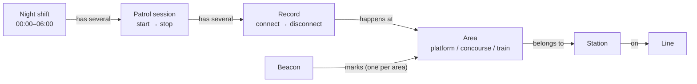

# Glossary

The words we use for the manning/patrol system, what they mean, and where they live in the code.

[How it fits together](#how-it-fits-together) · [Who decides what](#who-decides-what) · [Steward work](#steward-work) · [Places](#places) · [Patrol status](#patrol-status) · [Data](#data) · [Rules](#rules) · [Inconsistencies and naming traps](#inconsistencies-and-naming-traps)

## How it fits together

Metro must prove two things: every station area is patrolled at least once an hour, and trains are manned at least 70% of the time. This project mostly covers the patrol part.

A **night shift** (00:00–06:00) is split into **patrol sessions**: the steward stops the session for a break and starts a new one afterwards. During a session the phone listens for **beacons**. Every time it is near one, that is a **record**/**connectionevent**. A record counts as a **patrol** if it lasts 10 s on a platform or 20 s on a concourse.

**How the pieces connect:** a record links *who* (shift → session) to *where* (area → station → line).




## Who decides what

```
Steward app ──── events ────▶ Backend ──── dashboard stream ────▶ Dashboard + steward app
source of origin              source of truth                     display + adjustments
"what happened, and when"     "what it means"
```

- **The steward app is the source of origin.** It is the only thing that sees the beacons, so it decides which events exist and when they happened: connect, disconnect, session start, session stop, stamped with the phone's time.
- **The backend is the source of truth.** It stores the events and decides what they mean: it pairs them into records, decides what counts as a patrol, and what is at risk or overdue. Nobody else computes this.
- **The dashboard is neither.** It only shows what the backend sends. So does the status screen in the steward app.
- **One exception:** when a session stops, the backend adds the missing disconnect events itself, so the app does not have to.

This is why there are **events** in the app but **records** only in the backend: the app sends single facts ("I hear beacon X at 00:12"), and the backend turns pairs of them into records.

## Steward work

Paths: backend from `services/api/src/`, Android from `apps/android/src/`, web from `apps/web/src/`.

| Term | What it means | In code |
|---|---|---|
| Steward | The person on night duty, carrying the phone. | `android_id` on every event, `domain/event.py` |
| Night shift | The working night, 00:00–06:00 Copenhagen. The only shift that matters here. | `Shift` in `domain/shift.py`; times in `data/shifts.v1.json` |
| Patrol session | One stretch of work between start and stop. Breaks split a shift into several. | backend `api/v2/routers/patrol_session.py`; Android `components/SessionSlider.tsx`; event type `START_EVENT` / `STOP_EVENT` in `domain/event.py`sent over the API as shift_start / shift_stop; the db stores START_EVENT / STOP_EVENT |
| Record | One connect + its disconnect: the phone near one beacon. Built by the backend, never stored, never sent by the app. | `StewardPatrolInterval` in `domain/coverage.py`, built in `services/station_coverage/interval_builder.py` |
| Connect / disconnect | The phone starts or stops hearing a beacon. There's a rule that only sends a connection even when it has been connected for 4 seconds | backend `api/v2/routers/connection.py`; Android `types/beacon.ts` (`CONNECTED` / `DISCONNECTED`) |
| Pending / registered | A record still open / a record the server has closed. | contract only: `contracts/api/v2/patrol-record/` |

## Places

| Term | What it means | In code |
|---|---|---|
| Line | A metro line, M1 to M4. | `Line` in `db/models/line.py` |
| Station | A metro station, `STN-001` to `STN-042`. A station on two lines (e.g. M1 + M2) is stored once. | `Station` in `db/models/station.py`; its lines in `StationLine`, `db/models/station_line.py`; data in `data/stations.v1.json` |
| Area | A place in a station that must be patrolled. Each area has its own clock. | `PatrolArea` in `db/models/patrol_area.py`; Android `Area` in `types/station.ts` |
| Platform | Where the trains stop. Every station has one. UI: *Perron*. | `AreaKind.PLATFORM` in `domain/patrol_area.py` |
| Concourse | The hall above or below the platform. Some stations have one. UI: *Forhal*. | `AreaKind.CONCOURSE` in `domain/patrol_area.py` |
| Beacon | A small Bluetooth sender fixed in an area. Every area, platform or concourse, has exactly one. Hearing it means you are there. | `beacon_id` in `db/models/patrol_area.py` |
| Train | Also carries a beacon, for the 70% manning requirement. In the contract, not built yet. | contract only: `contracts/api/v2/positioning-interface/` |

## Patrol status

| Term | What it means | In code |
|---|---|---|
| Patrolled | A record that lasted long enough to count. | `qualifies_as_patrolled` in `domain/coverage.py` |
| Minimum duration | How long counts: 10 s platform, 20 s concourse. | `MIN_QUALIFYING_DURATIONS` in `services/station_coverage/coverage_window.py` |
| Rolling hour | An area must be patrolled within the last 60 minutes, measured from now, not per clock hour. | `TIME_UNTIL_NEXT_NEEDED_PATROL` in `services/station_coverage/coverage_window.py` |
| Covered now | A steward is in the area right now and has been long enough. | `covered_now` in `domain/coverage.py` |
| Overdue | The 60 minutes ran out and nobody has patrolled since. Red. UI: *Overskredet*. | `overdue_at` in `domain/coverage.py`; shown by Android `utils/areaStatus.ts`, web `utils/TimeColor.tsx` |
| At risk | Close to overdue, 10 minutes by default (adjustable). Yellow. UI: *I risiko*. | `at_risk_threshold_minutes` in `db/models/config.py`, `api/v2/routers/config.py` |
| Overdue episode | One stretch of being overdue, from deadline to the next patrol. | `OverdueEpisode` in `domain/coverage.py` |
| Overdue log | The permanent list of overdue episodes, written by the server. | `OverdueLogEntry` in `db/models/overdue_log.py`, written by `services/station_coverage/overdue_tracker.py` |

## Data

| Term | What it means | In code |
|---|---|---|
| Event | One fact the phone reported: connect, disconnect, session start or stop. | `Event` in `db/models/event.py`; in memory `EventRecord` in `domain/event.py` |
| Event store | All events and adjustments, only ever added to, never changed or deleted. | `services/event_producer.py`, `db/repository/event.py` |
| Adjustment | A correction, appended as its own row: what really happened, which event it corrects, who corrected it and why. The original event stays untouched. Not used by coverage yet. | `Adjustment` in `db/models/adjustment.py`, appended by `append_adjustment` in `services/event_producer.py` |
| Device time / server time | When it happened on the phone / when the server saved it. Device time is the one we use. | `device_timestamp` / `server_timestamp` in `db/models/event.py` |
| Dashboard stream | The live feed the backend pushes to the dashboard and the app.  | backend `api/v2/routers/dashboard_stream.py`; web `hooks/useDashboardStream.ts`; Android `api/stationEventStream.ts` |

## Rules

1. A station has one platform and at most one concourse. Every area has exactly one beacon.
2. A visit counts as a patrol after 10 s on a platform or 20 s on a concourse.
3. Every area must be patrolled within a rolling 60 minutes.
4. Areas are separate: patrolling the platform does nothing for the concourse.
5. A station is overdue if any one of its areas is.
6. At shift start every area gets a free hour. Never patrolled means overdue at 01:00.
7. Outside the shift nothing changes: coverage is frozen at 06:00.
8. Stopping a session closes every open record of that steward.
9. Events are never edited or deleted. A mistake is fixed by appending an adjustment that points at the wrong event. *Coverage does not read adjustments yet.*
10. The phone's time decides when something happened.
11. Presence comes from beacons only. No beacon, not present.
12. A beacon counts as lost after 10 s of silence. *Decided ([ADR-0006](adr/0006-tolerated-gap-decision.md)), not built yet.*

Code: rules 2–7 live in `services/api/src/services/station_coverage/` (mainly `coverage_window.py`) and `services/api/src/domain/coverage.py`; rule 8 in `interval_builder.py` and `event_producer.py`.

## Inconsistencies and Naming traps

- **`shift_start` / `shift_stop` mean patrol session**, not shift. They are the names sent in the API and contracts; the database stores `START_EVENT` / `STOP_EVENT`. The names are older than the shift concept.
- **`EventRecord` is not a record.** It is one event, the backend's in-memory copy of an `Event` row. A record (connect + disconnect) is `StewardPatrolInterval`.
- **Area** is also called *level* or *station level*. Its kind is `area_kind` in the backend and `area_type` in the contracts.
- **`manned`** in the web code means *covered now*. Elsewhere *manned* is about trains.
- **`android_id`** is a phone id, but the contracts and `current_steward_ids` treat it as the steward. Working assumption: each steward has their own phone. To be confirmed by the team.
- **Adjustment of an adjustment:** the draft contract says an adjustment may point at another adjustment, but the code only accepts an event as the target.
- **Beacon as the area's identity:** the data README says an area is identified by its area id (`PA-001-P`) and the beacon is only an attribute, so a swapped beacon keeps the same area. The database uses `beacon_id` as the primary key of `PatrolArea` (`db/models/patrol_area.py`), so a swapped beacon means a new area row.
